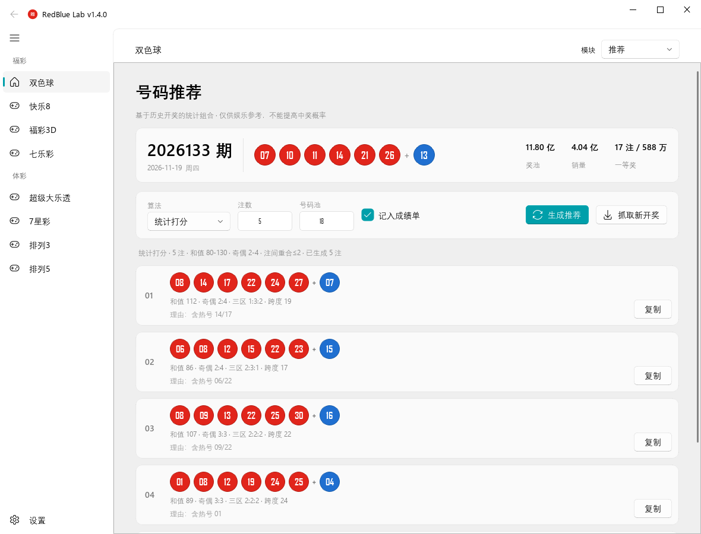
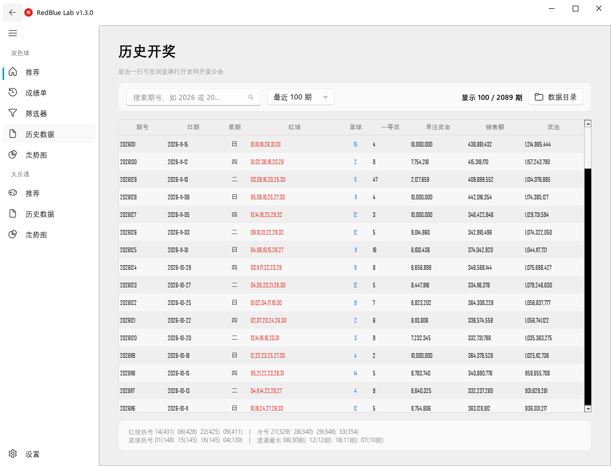
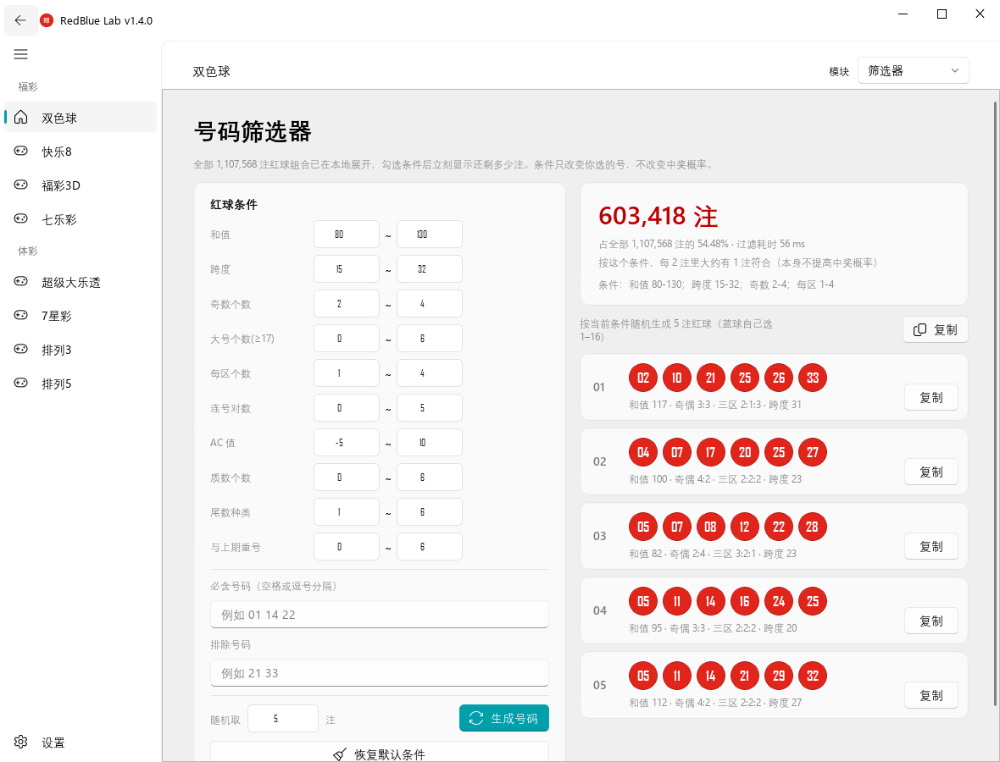
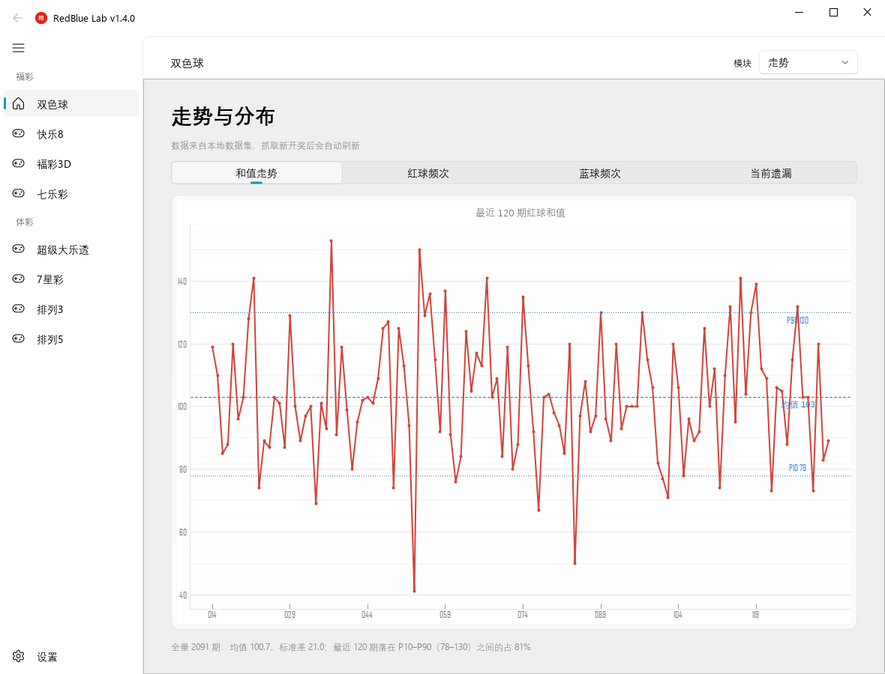
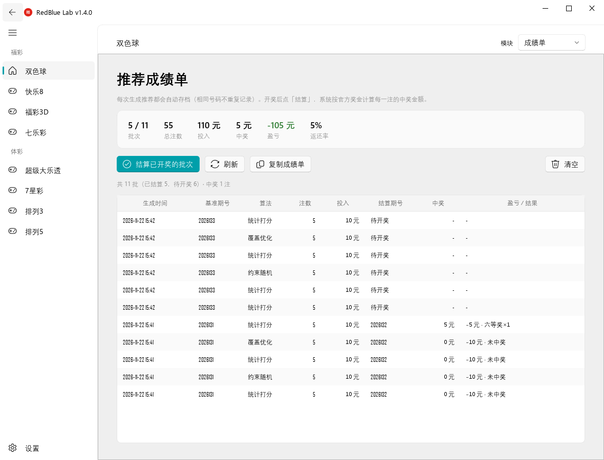
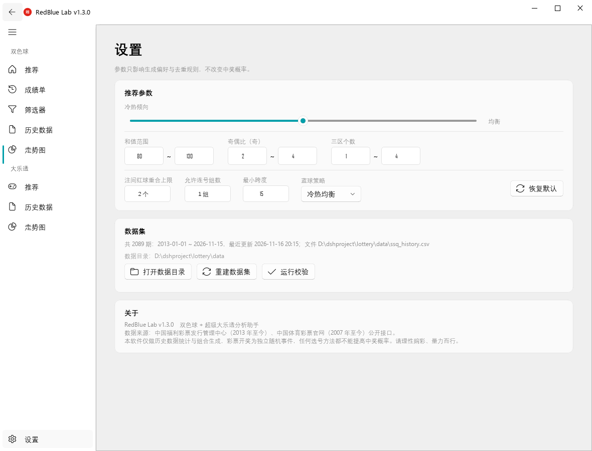
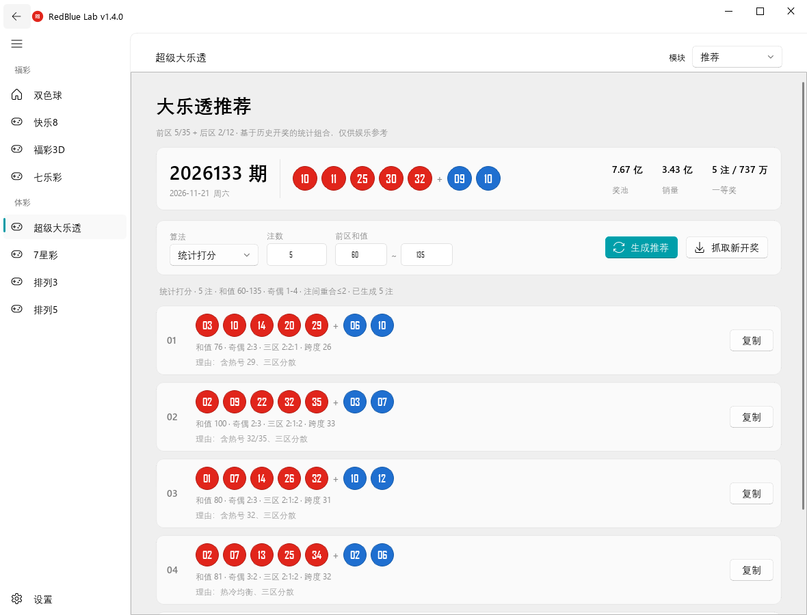
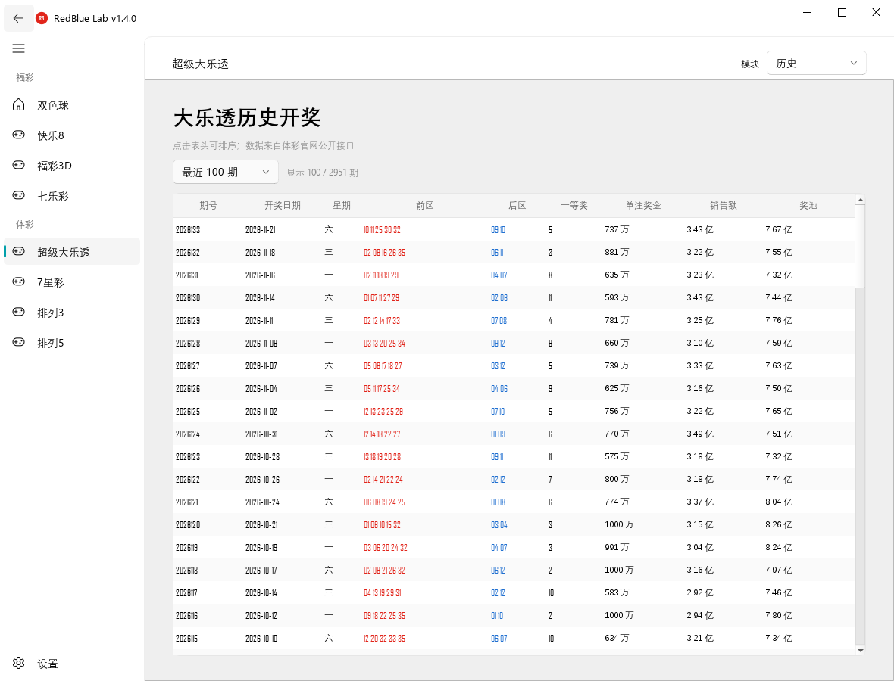
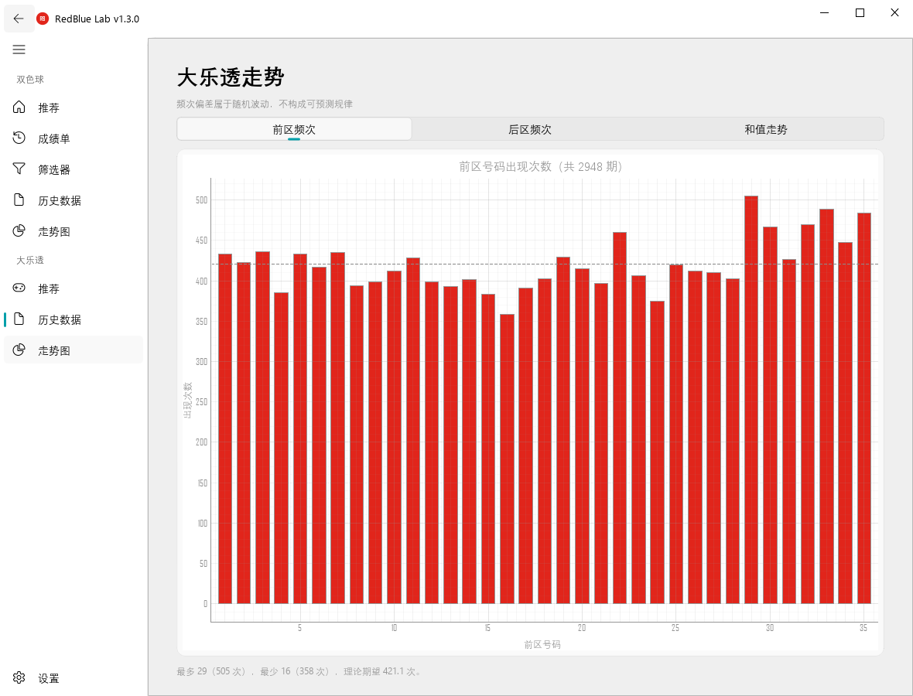

# RedBlue Lab · 双色球 + 超级大乐透分析助手

[](LICENSE)
[](https://www.python.org/)
[](https://pypi.org/project/PySide6-Fluent-Widgets/)
[](https://github.com/Urtaome0211/RedBlueLab/releases)

抓取中国福利彩票双色球、中国体育彩票超级大乐透的往期开奖数据，并做成一个 **Qt-Fluent 桌面应用**：
浏览历史、看走势分布，基于历史统计生成下注推荐（双色球还能算覆盖保底、按条件筛号、自动记账复盘），
一键抓取新开奖。

> 彩票开奖是独立随机事件，**任何选号方法都不能提高中奖概率**。本工具只做历史数据统计、
> 组合过滤与展示，供研究/娱乐使用。请理性购彩。



| 历史数据 | 号码筛选器 |
| --- | --- |
|  |  |

| 走势分布 | 推荐成绩单 | 设置 |
| --- | --- | --- |
|  |  |  |

**超级大乐透**（前区 5/35 + 后区 2/12）：

| 大乐透推荐 | 大乐透历史 | 大乐透走势 |
| --- | --- | --- |
|  |  |  |

## 功能

- **号码推荐**：三种算法随时切换——「统计打分」（按历史频次 + 遗漏加权抽样，含热号理由）、
  「约束随机」（在和值 / 奇偶 / 三区 / 连号 / 跨度约束下随机，不看历史热度）、
  「**覆盖优化**」（先从号码池里挑 N 注，让「池内无论开出哪 6 个号，至少都中几红」最大化，
  页面上直接给出保底红球数与池大小）；生成 1–20 注，自动去重，每注可一键复制。
- **推荐成绩单**：每次生成自动存档（同号码不重复记录），开奖后点「结算已开奖的批次」按官方
  奖金逐注计算中奖等级与盈亏，统计投入/中奖/返还率，可复制整份成绩单。
- **号码筛选器**：本地缓存的全部 **1,107,568** 注红球组合，按和值 / 跨度 / 奇数 / 大号 /
  每区个数 / 连号对 / AC 值 / 质数 / 尾数种 / 与上期重号 / 必含 / 排除 实时过滤，
  立刻显示剩余注数、占比与耗时，并可随机抽号（只出红球，蓝球自己配）。
- **一键抓取**：点「抓取新开奖」即可增量同步官网数据，后台线程执行、界面不卡；
  抓完自动重建数据集并刷新所有页面。
- **历史数据**：2089 期表格（期号 / 日期 / 号码 / 奖级 / 销量 / 奖池），支持按期号搜索、
  切换显示 50/100/500/全部，双击在浏览器打开官网公告页；底部显示红蓝球冷热与最长遗漏。
- **走势分布**：红球和值走势（叠加历史均值与 P10–P90 区间）、红球/蓝球出现频次、
  当前遗漏期数四张图，可缩放平移。
- **设置**：冷热倾向、和值区间、奇偶比、三区个数、注间重合上限、连号组数、最小跨度、
  蓝球策略；参数持久化到 `config.json`，并可重建数据集 / 运行校验 / 打开数据目录。
- **超级大乐透**（侧栏「大乐透」分组）：独立的抓取 / 推荐 / 历史 / 走势 ——
  「统计打分」与「约束随机」两种算法，约束涵盖前区和值、奇偶比、三区分布、连号、跨度、
  注间重号上限，并同样显示每注理由、一键复制；历史表格 2948 期（2007-05-30 起），
  走势页含前区频次、后区频次、前区和值走势，另附单注期望回报估算。

## 下载

打包好的 Windows 版本在 [Releases](https://github.com/Urtaome0211/RedBlueLab/releases)：

| 文件 | 说明 |
| --- | --- |
| `RedBlueLab-v1.0-win64-folder.zip` | **推荐**。解压后双击 `RedBlueLab\RedBlueLab.exe`，启动最快、不写临时目录 |
| `RedBlueLab-onefile.exe` | 单文件版，首次启动要把自身解压到 `%LOCALAPPDATA%\RedBlueLab\tmp` |

想自己构建就看下面的「方式二」与「方式三」。

## 快速开始

### 方式一：直接运行（无需安装 Python）

`dist\` 下有两种打包产物，任选其一：

| 产物 | 说明 |
| --- | --- |
| `dist\RedBlueLab\RedBlueLab.exe` | **推荐**。文件夹版，双击即开，不写临时目录，启动最快；整个文件夹约 176 MB，移动时要连目录一起拷 |
| `dist\RedBlueLab-onefile.exe` | 单文件版（67 MB），方便只传一个文件；每次启动把自身解压到 `%LOCALAPPDATA%\RedBlueLab\tmp`，首次会慢几秒 |

单文件版已把解压目录固定到 `%LOCALAPPDATA%\RedBlueLab\tmp`（不再依赖 `%TEMP%`）。如果这台机器连
`%LOCALAPPDATA%` 都不可写（安全软件、组策略、便携环境），双击同目录的 `dist\单文件版启动.bat`，
它会把临时目录指到脚本旁边的 `runtime_tmp` 再启动。文件夹版不受此问题影响。

首次启动会把内置的种子数据解压到 `%LOCALAPPDATA%\RedBlueLab\data`，之后抓取与重建都写
在那里；想恢复出厂状态，直接删掉该目录再启动即可。若该目录不可写（受限账户 / 便携盘），
程序会自动退到 exe 同目录的 `data\`，再不行则退到 `%TEMP%\RedBlueLab`。

打包版没有控制台，可用 `RedBlueLab.exe --selftest` 做一次「建窗口后立即退出」的
启动自检（返回码 0 即正常），排障时设置环境变量 `SSQ_BOOT_LOG=<路径>` 可把启动过程
写成日志。

### 方式二：从源码运行

```bash
# 1) 建虚拟环境并装依赖
python -m venv .venv
.venv\Scripts\python.exe -m pip install -r requirements.txt

# 2) 启动界面
run.bat                     # 或 .venv\Scripts\pythonw.exe main.py
```

依赖清单见 [requirements.txt](requirements.txt)：PySide6-Essentials、PySide6-Fluent-Widgets、
pyqtgraph、pandas、openpyxl（抓取只用标准库 `urllib`）。

### 方式三：打包自己的 exe

```powershell
pwsh -File build_exe.ps1     # 产物：dist\RedBlueLab\（文件夹版）与 dist\RedBlueLab-onefile.exe（单文件版）
```

打包脚本会把 `data/ssq_history.csv` 与 21 个分页原始 JSON 作为种子塞进包里，
所以 exe 首次启动就有完整数据、离线也能「重建数据集」。

> PyInstaller 的 `--noconsole` 会把 `sys.stdout/stderr` 置为 None，而 qfluentwidgets
> 导入时会往标准输出打一行提示，直接打包会静默卡死。`main.py` 顶部已把这两个流接到
> `os.devnull`，改动入口时不要删掉那段保护。

## 常见问题

- **双击 `run.bat` 闪退**：已修复（原脚本是 LF 换行 + UTF-8 中文，cmd 会解析错乱）。
  若仍打不开，用控制台跑 `.venv\Scripts\python.exe main.py` 看报错；
  崩溃堆栈会写到 `%LOCALAPPDATA%\RedBlueLab\crash.log` 并弹窗提示。
- **exe 双击没反应 / 弹 `Could not create temporary directory!`**：这是单文件版解压失败，
  先跑 `RedBlueLab.exe --selftest`，返回 0 说明程序本身正常；再按上表改用文件夹版
  `dist\RedBlueLab\RedBlueLab.exe`，或双击 `dist\单文件版启动.bat`（把临时目录固定到
  脚本旁边），最后再检查杀毒软件是否拦截。
- **数据想恢复出厂**：删掉 `%LOCALAPPDATA%\RedBlueLab` 目录，重新启动会重新解压种子数据。

## 推荐算法

三种算法都**不改变中奖概率**，区别只在抽样偏好与可解释性。

**统计打分 `stats`**

1. 红球权重 = `hot_bias × 热度 + (1 - hot_bias) × 遗漏度`，其中热度由「全历史出现次数」
   与「近 50 期出现次数」各占 0.65/0.35 做 z-score 合成，遗漏度是距最近一次开出的期数；
   权重经 softmax 转成概率后不放回抽 6 个。
2. 过滤：和值落在设定区间、奇数个数在区间内、三区个数在区间内、
   连号组数 ≤ 上限、跨度 ≥ 下限。
3. 贪心挑选：与已选注红球重合超过上限的候选丢弃，蓝球尽量不重复。

**约束随机 `random`**

同上的过滤与去重规则，但号码等概率抽取，不考虑历史热度，用于对照。

**覆盖优化 `coverage`**

1. 先按权重选出一个 **号码池**（12–20 个号，三区各至少 2 个）——池子越小，保底越高。
2. 从池内候选里贪心挑选 N 注，目标不是「最可能中」，而是让池内任意 6 个号的组合
   在你这 N 注上命中的**红球数最小值最大**（`floor`）；再用单点替换做局部搜索微调。
3. 结果按「保底红球数 → 最差情况占比 → 平均命中」排序，页面会写明
   「池内 6 个全中时最差也中 X 红（平均 Y.Y 红）」。

> 实测：18 个号的池 + 5 注，保底 2 红（约 4% 的池内组合只能中 2 红），平均 3.2 红；
> 换成 15 个号的池，保底能到 3 红。**买得越多、池子越小，保底越高**——但这依然是
> 覆盖设计，不改变单注中奖概率。

**号码筛选器**

对全部 `C(33,6) = 1,107,568` 注红球做条件过滤，条件都是「区间 + 必含/排除」：
和值、跨度、奇数个数、大号个数（≥17）、每区个数、连号对数、AC 值、质数个数、
尾数种类、与上期重号个数。默认条件（和值 80–130、奇数 2–4、每区 1–4）剩 603,418 注。

**期望回报**（页面底部实时计算）

- 头奖组合数 `C(33,6) × 16 = 17,721,088`
- 按历史各奖级奖金均值估算：每注 2 元，期望回报约 **1.08 元（返还率 ≈54%）**
- 结论：长期期望为负，推荐结果只是「好看的组合」，不是提高中奖率的方案

## 目录结构

```
main.py                  程序入口（python main.py 或打包后 exe）
run.bat                  源码方式启动（优先 pythonw，不弹黑框）
build_exe.ps1            PyInstaller 单文件打包脚本
requirements.txt         运行依赖
dlt/
  fetch.py               体彩官网接口抓取（30 页缓存）
  build.py               解析 → 派生列 → 校验 → 导出 CSV/JSON/XLSX
  store.py               大乐透数据集与特征（前/后区频次、遗漏、和值）
  recommend.py           统计打分 / 约束随机 + 奖金期望
  ui.py                  大乐透推荐 / 历史数据 / 走势图三个页面
ssq/
  paths.py               路径解析（源码运行 vs exe 运行、种子数据铺设）
  config.py              参数持久化（config.json）
  core/fetch.py          官网接口抓取（分页、重试、页缓存、总期数变化自动作废）
  core/build.py          解析 → 派生列 → 校验 → 导出 CSV/JSON/XLSX
  core/store.py          数据集加载、特征（频次/遗漏/和值）缓存
  core/recommend.py      统计打分 / 约束随机 / 覆盖优化三种算法 + 期望回报
  core/ledger.py         推荐成绩单：存档、按期结算中奖、盈亏统计（picks.json）
  core/expand.py         复式/胆拖展开与输入解析
  core/universal.py      全部 1,107,568 注红球组合 + 条件筛选引擎
  ui/main_window.py      Fluent 主窗口 + 导航
  ui/widgets.py          号码球、注卡、数字输入框等自定义控件
  ui/pages/              推荐 / 成绩单 / 筛选器 / 历史数据 / 走势图 / 设置 六个页面
tools/screenshot.py      无显示器环境下渲染各页面截图（界面自查）
tools/smoke_test.py      无界面功能自检（三种算法、成绩单、筛选器、联动、图表、抓取）
tools/demo_ledger.py     生成一份演示用成绩单（截图/文档用，不影响真实存档）
tools/make_icon.py       生成 assets/app.ico（exe 图标）
crawl_dlt.py             大乐透抓取命令行入口
build_dlt_dataset.py     大乐透数据集重建入口
assets/app.ico           应用图标
docs/screenshots/        界面截图（README 与 release 用）
LICENSE                  MIT 协议
```

## 数据集

| 项目 | 内容 |
| --- | --- |
| 记录数 | **2089 期** |
| 时间范围 | **2013-01-01（2013001 期）～ 2026-11-15（2026131 期）** |
| 字段数 | 33 列（号码 / 奖级 / 销量 / 奖池 / 派生指标） |
| 数据来源 | 官网前端接口 `findDrawNotice`（页面本身即调用此接口，`name=ssq`） |
| 抓取时间 | 2026-11-16 |

> **关于起始年份**：`cwl.gov.cn` 改版后只保留 **2013 年及以后**的开奖数据——实测
> `issueStart=2003001`、`dayStart=2003-01-01` 等查询均返回 0 条，最早一页止于 `2013001`。
> 因此数据集覆盖的是该页面**实际提供的全部历史**（2003–2012 年的 1600 余期需另找数据源）。

**导出文件**：`data/ssq_history.xlsx`（5 个工作表：开奖记录 / 一等奖明细 / 红球频次 /
蓝球频次 / 校验报告）、`data/ssq_history.csv`（`utf-8-sig`）、`data/ssq_history.json`、
`data/raw/page_*.json`（接口原始响应）。

**字段**：`期号`、`开奖日期`、`星期`、`红球`（逗号分隔）、`红球1`～`红球6`、`蓝球`、
`一~六等奖注数`、`一~六等奖单注奖金(元)`、`一等奖派奖说明`（2013–2015 派奖期形如
`5490089（含派奖172413）`，金额取含派奖总额）、`销售金额(元)`、`奖池金额(元)`、
`红球和值`、`跨度`、`奇偶比`、`大小比`（≥17 为大）、`三区比`（1-11 / 12-22 / 23-33）、
`中奖地区`、`详情链接`。

**校验**：期号唯一；红球均为 6 个两位号码、互不重复且在 1–33，蓝球在 1–16；
日期可解析且严格倒序；按年期号连续无断号；一等奖注数 / 单注奖金 / 销售额 / 奖池
完整率 100%；以 2026122 期官网公告页交叉核对销售额 `364,308,228`、一等奖单注
`6,823,202` 一致。

## 命令行用法（不带界面）

```bash
python crawl_ssq.py                 # 增量抓取（复用 data/raw 缓存）
python crawl_dlt.py                 # 抓取大乐透全部历史（30 页）
python build_dlt_dataset.py         # 重建大乐透数据集
python crawl_ssq.py --refresh       # 忽略缓存全量重抓
python build_dataset.py             # 解析 + 校验 + 导出 CSV/JSON/Excel
python stats.py                     # 打印最新几期与汇总统计
python check_new.py                 # 对比官网，列出尚未入库的新期
```

## 抓取策略（合规）

- 仅请求官网公开前端接口，间隔 1 秒，共 21 次请求，行为与正常浏览一致
- 失败指数退避重试（最多 5 次），分页落盘缓存，支持断点续抓
- 数据版权归中国福利彩票发行管理中心，仅供个人研究/统计学习使用

## 数据速览（双色球 2013–2026，2089 期）

- 最新一期 2026131（2026-11-15）：红 `01 10 19 26 31 33` + 蓝 `15`，一等奖 4 注 / 1000 万元，奖池 12.15 亿元
- 红球热号：`14`(431)、`06`(428)、`22`(425)；冷号：`21`(329)、`28`(340)、`29`(348)
- 蓝球热号：`01`(148)、`15`(145)、`16`(145)；冷号：`13`(111)、`09`(115)、`10`(118)
- 和值集中在 80–120（占 67.3%）；奇偶比 `3:3` 占 35.3%
- 一等奖空开 18 期；单期最多 153 注（2019052）；单注最高 1500 万元（2015146，派奖期）

## 大乐透数据（2007–2026，2948 期）

- 数据源：中国体育彩票官网公开接口
  `https://webapi.sporttery.cn/gateway/lottery/getHistoryPageListV1.qry?gameNo=85`（分页缓存 30 页）。
- 期号：官网返回 5 位（如 `26130`），本工具统一补成 7 位（`2026130`）以便排序比较。
- 字段：期号 / 开奖日期 / 星期 / 前区 / 后区 / 前区 1–5 / 后区 1–2 / 销售额 / 奖池 /
  一、二等奖注数与单注奖金 / 三–七等奖注数与单注奖金 / 前区和值 / 跨度 / 奇偶比 / 大小比 /
  三区比 / 详情链接（共 36 列）。
- 数据源历史缺口（不是解析问题）：销售额自 2016078（2016-07-06）起才有；一等奖单注奖金在
  「一等奖 0 注」的空开期没有；七等奖自 2019019 起才增设。校验报告把这些标为「提示」。
- 奖级对应：一等 5+2、二等 5+1、三等 5+0（5000）、四等 4+2（300）、五等 4+1（150）、
  六等 3+2（15）、七等 3+1 / 2+2 / 3+0 / 1+2 / 2+1 / 0+2（5）。
- 全部组合 21,425,712 种；按历史奖金估算单注（2 元）期望回报约 0.94 元（返还率约 47%）。

## 开源协议

本项目使用 **MIT License**，版权归 [Urtaome0211](https://github.com/Urtaome0211) 所有：

```
MIT License

Copyright (c) 2026 Urtaome0211
```

可以自由使用、修改、分发甚至商用，只需保留版权声明与许可声明；软件按「现状」提供，
不对开奖结果或任何形式的收益作担保。完整条款见 [LICENSE](LICENSE)。

## 合规与免责

- 仅抓取官网公开接口（双色球 `cwl.gov.cn`、大乐透 `sporttery.cn`），请求间隔 1 秒，
  行为与正常浏览一致；数据版权归相应发行机构，本仓库仅做个人研究/统计学习的二次整理。
- 本项目与任何彩票发行、销售机构无关联，不提供代购、预测、稳赚类服务。
- 彩票开奖是独立随机事件，历史频次与走势**不构成预测依据**；请理性购彩、量力而行。

## 更新记录

- 2026-11-16 增量抓取双色球 2026128～2026131 共 4 期（2085 → 2089 期）
- 2026-11-16 应用改名为 **RedBlue Lab**（v1.3.0）：窗口标题、exe 名、图标（RB）、数据目录
  `%LOCALAPPDATA%\RedBlueLab` 一并更新；旧目录 `SSQAdvisor` 的数据首次启动自动迁移
- 2026-11-16 新增**超级大乐透**模块（抓取 + 数据集 + 推荐 + 历史 + 走势），
  侧栏改为「双色球 / 大乐透」两个分组；版本 1.2.0。
- 2026-11-08：**v1.1.0** 三项新功能
  - 推荐成绩单：每次生成自动存档（`picks.json`），开奖后按官方奖金结算中奖等级与盈亏
  - 覆盖优化算法：号码池 + 保底红球数，页面上直接给出「池内最差也中几红」
  - 号码筛选器：1,107,568 注全组合的实时条件过滤，剩余注数/占比/耗时 + 随机抽号
  - 修复 `--selftest` 退出码 0xC0000409（推荐/筛选线程未退出，新增 `MainWindow.shutdown()`）
  - 筛选器表单改用固定宽度标签 + 原生数字框，只出红球（蓝球自选）
- 2026-11-07：新增 Qt-Fluent 桌面应用（推荐 / 历史 / 走势 / 设置 + 抓取按钮 + 单文件 exe）
  - 修复打包版启动卡死：`--noconsole` 下 `sys.stdout` 为 None 导致 qfluentwidgets 导入期异常
  - 数值输入框改用原生 `QSpinBox` 自绘（qfluentwidgets 自带 SpinBox 行编辑宽度恒为 1px）
  - 修复 `run.bat` 闪退（LF 换行 + UTF-8 中文导致 cmd 解析错乱，改为 CRLF 纯 ASCII，兼容无 venv 的情况）
  - 启动异常不再静默退出：写 `crash.log` 并弹窗提示错误摘要
  - 打包改为两种产物：文件夹版 `dist\RedBlueLab\`（不写临时目录，推荐）与单文件版
    `dist\RedBlueLab-onefile.exe`（附 `dist\单文件版启动.bat`，解决
    `Could not create temporary directory!`）
- 2026-11-07：增量抓取 2026123～2026127 共 5 期（总期数 2080 → 2085）
- 2026-10-26：首次全量抓取 2080 期
